<!-- omri@arch:~$ cat README.md -->
<div align="center">

<a href="https://github.com/omribenami/"></a>

<sub><code>// real-world AV ops by day · builder by night · everything runs on Linux</code></sub>

</div>

<br/>

**By day** I lead US technical operations for an autonomous driving program — bridging engineering, operations and customers so complex AV technology works on real streets. My background: international AV integration, cross-functional teams, and real-world deployment across multiple countries.

**After hours** I'm a hands-on builder. I experiment with AI agents, local LLMs, voice interfaces, computer control, robotics and smart-home hardware — mostly on Linux, mostly to see what AI can do once it leaves the screen.

Same instinct on both sides: take a complex system out of the lab and make it work in the real world.

<sub>The repos here are personal experiments and passion projects, not my day job.</sub>

```console
omri@arch:~$ whoami --verbose
  day_job    : US technical operations lead · autonomous driving program
  background : international AV integration · real-world deployment · cross-functional teams
  builds     : AI agents · voice interfaces · robotics & IoT experiments
  interests  : agentic AI · local LLMs · computer control · smart home
  stack      : Arch Linux + Hyprland (Omarchy) · Python · ESP32
  mindset    : build it, test it in the real world, iterate
  location   : Austin, TX
```





<p align="center">
<a href="https://github.com/omribenami/Omarchy-AI"></a>
<a href="https://github.com/omribenami/jev-operated-drone"></a>
<a href="https://myapiai.com"></a>
<a href="https://github.com/omribenami/omarchy-ai-plugin"></a>
<a href="https://github.com/omribenami/OpenWakeWord-HEB"></a>
<a href="https://github.com/omribenami/ha-amazon-order-status"></a>
</p>

<details>
<summary><code>ls ~/lab --more</code></summary>
<br/>

| repo | what it is |
|---|---|
| [myapi-asc-mcp](https://github.com/omribenami/myapi-asc-mcp) | MCP server for MyApi — Ed25519 (ASC) signing handled transparently for AI agents |
| [myapi-cursor-plugin](https://github.com/omribenami/myapi-cursor-plugin) | MyApi plugin for Cursor and Grok Bot |
| [smart_cactus](https://github.com/omribenami/smart_cactus) | ESP32 voice assistant with motor control and LEDs, inside a cactus toy |
| [moltworker_conversation](https://github.com/omribenami/moltworker_conversation) | fork: Home Assistant component that gives OpenClaw access to the smart home |
| [Back_up_Bash_Script](https://github.com/omribenami/Back_up_Bash_Script) | Linux Bash script for Home Assistant backups |
| [JarvisGPT](https://github.com/omribenami/JarvisGPT) · [pedagogy-bot](https://github.com/omribenami/pedagogy-bot) | early GPT assistant experiments |

</details>


<p align="center">
    <br/>
    <br/>
    
</p>


```diff
+ [omarchy-ai]   pre-alpha, published on OmaStore — installable from the Omarchy app store
+ [omarchy-ai]   realtime voice via OpenAI / Gemini live models, jev as decision hub
+ [jev-drone]    test flight: target person found in 53s (127s before)
+ [myapi]        MCP server with transparent Ed25519 (ASC) request signing
# next: more physical AI — agents that leave the screen
```


<p align="center">
<a href="https://github.com/omribenami/"></a>
<a href="https://myapiai.com"></a>
<a href="https://github.com/omribenami/Omarchy-AI/releases/latest"></a>
</p>


